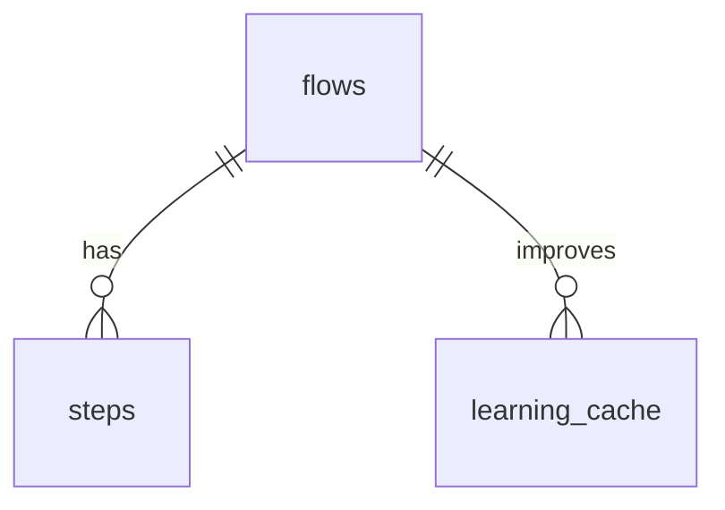

# Database Design (DBA)

## Core Tables
- flows
- steps
- roles

## AI Cache
- ai_cache
- embedding_cache

## Learning Cache
- learning_cache

## Diagram

## Optimization
- Index embeddings
- Use pgvector
