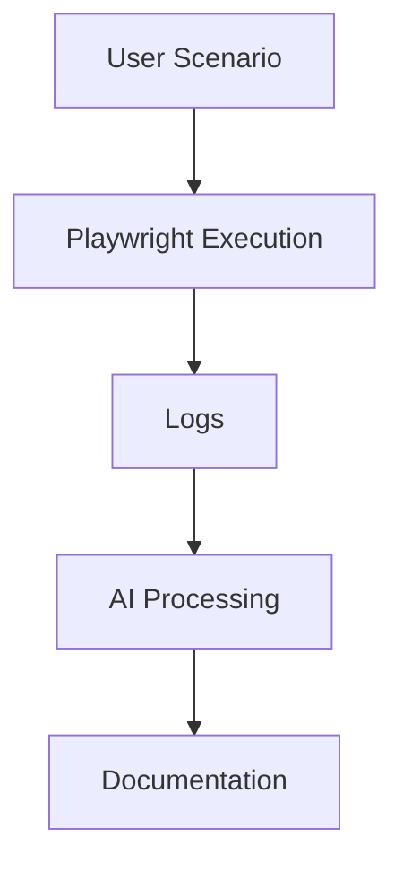

# System Analyst

## Problem Statement
Manual QA and documentation are inefficient, inconsistent, and not scalable.

## Solution
AI-powered system that:
- Explores UI automatically
- Generates documentation
- Detects bugs
- Learns over time

## Key Flows

## Features
- Role-based flows
- Scenario-based documentation
- Goal detection
