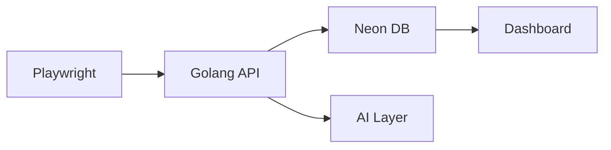

# System Architect

## Architecture Overview

## Components
- Explorer (Node)
- Backend (Go)
- DB (Neon + pgvector)
- Dashboard (React)

## Design Principles
- Decoupled services
- AI-first pipeline
- Learning-based system
