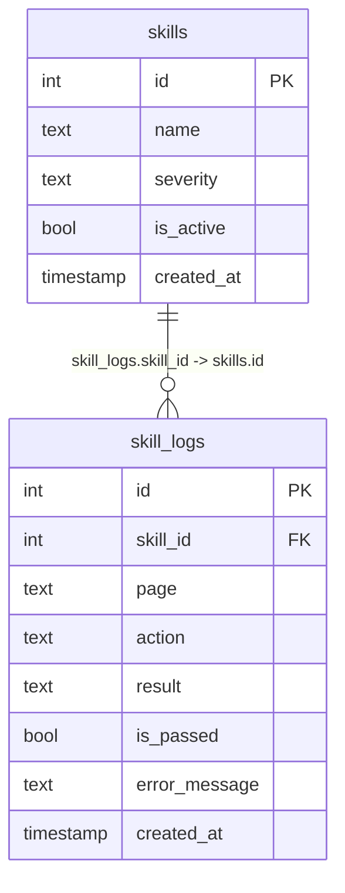
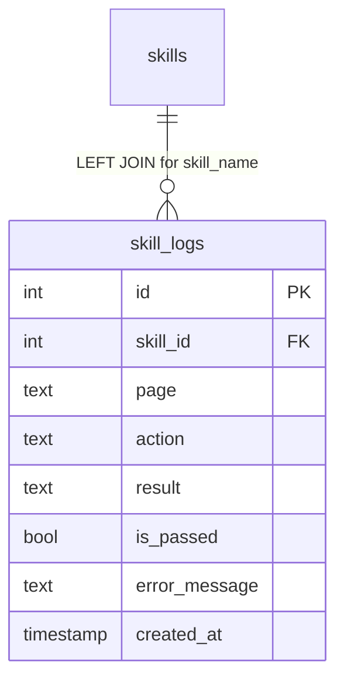
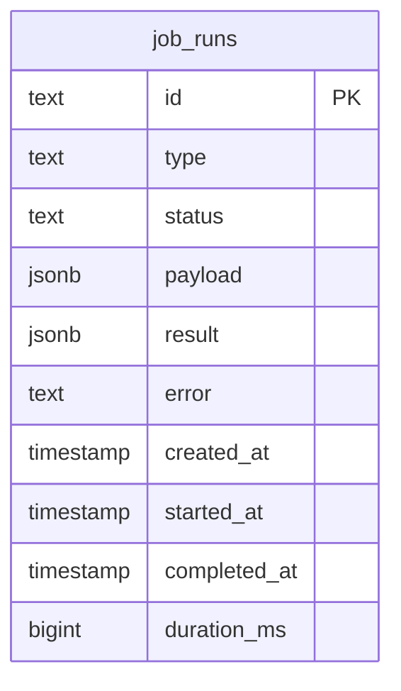

# Backend Part 2 Fullstack Implementation Summary (Task: Missing APIs for Full Server-Driven Completion)

Date: 2026-04-23  
Owner: Senior Fullstack Developer (`ai-backend` + `dashboard`)

## Scope

Implemented ONLY the missing API scope from:
- `_docs/markdown-results/findings/202604/dashboard-part-2-implementation-summary-task-all.md`
- Section: **Missing APIs for full server-driven completion**

APIs completed:
1. `GET /api/skills/stats` with server-side query + pagination contract
2. `GET /api/skills/logs` with server-side query + pagination contract
3. `GET /api/jobs` with persisted audit history + pagination contract

---

## Phase 1 Plan (Executed)

1. Verify Neon DB connectivity and inspect tables directly.
2. Map table relationships for target APIs.
3. Implement backend API contracts + persistence.
4. Add/extend integration tests.
5. Integrate dashboard to consume new server-driven contracts.
6. Re-verify backend endpoints and frontend build.

Risks identified and addressed:
- Legacy clients expecting array-only responses: dashboard updated to consume `{data, pagination}`.
- Job history previously in-memory only: persisted table added (`job_runs`) and lifecycle upserted.
- Nullable `error_message` in `skill_logs`: defensive scan fix applied.

---

## Database Verification and Table Inspection

Neon connectivity verified via `psql`.

Observed base table list includes required tables:
- `skills`
- `skill_logs`
- `job_runs` (added by migration)

Point-in-time counts during verification:
- `skills_count = 4`
- `skill_logs_count = 2`

Health check target validated:

```json
{"status":"ok","database":"connected","minimax":"configured"}
```

---

## Table Relationships (Mermaid)

### 1) `GET /api/skills/stats`



### 2) `GET /api/skills/logs`



### 3) `GET /api/jobs`



---

## Backend Implementation Details (`ai-backend`)

### A. Persisted Job Audit and Listing

- Added `job_runs` table migration with indexes:
  - `idx_job_runs_type`
  - `idx_job_runs_status`
  - `idx_job_runs_created_at`
- Job lifecycle now upserts to DB on create and completion.
- Added `GET /api/jobs` supporting:
  - query params: `type`, `status`, `page`, `limit`, `sort_by`
  - response:

```json
{
  "data": [],
  "pagination": { "page": 1, "limit": 20, "total": 0, "total_pages": 1 }
}
```

- `GET /api/jobs/:id` now falls back to DB when in-memory record is missing.

### B. `GET /api/skills/logs`

Completed additions:
- server-side pagination: `page`, `limit`
- server-side search: `search`
- maintained existing filters: `skill_id`, `passed`, `from_date`, `to_date`
- backward compatibility: legacy non-numeric `page` still treated as exact path filter
- response now standardized to:

```json
{
  "data": [],
  "pagination": { "page": 1, "limit": 20, "total": 0, "total_pages": 1 }
}
```

### C. `GET /api/skills/stats`

Completed additions:
- server-side search: `search`
- server-side sort: `sort_by`
- server-side pagination: `page`, `limit`
- response now standardized to:

```json
{
  "data": [],
  "pagination": { "page": 1, "limit": 20, "total": 0, "total_pages": 1 }
}
```

---

## Frontend Integration (`dashboard`)

### `dashboard/src/views/SkillsView.tsx`

- Stats tab updated to consume paginated backend contract (`/api/skills/stats`).
- Logs tab updated to consume paginated backend contract (`/api/skills/logs`).
- Removed previous warning/fallback UI about missing server pagination.
- Added paging controls for stats and logs similar to skills tab.

### `dashboard/src/views/QAInsights.tsx`

- Action audit now initializes from persisted backend history:
  - `GET /api/jobs?page=1&limit=12&sort_by=created_newest`
- Existing live job polling (`POST /api/jobs/*` + `GET /api/jobs/:id`) remains intact.

---

## Tests and Verification

## Backend integration tests (Neon-backed)

Command:
- `cd ai-backend && GOCACHE=/tmp/go-build-cache go test ./internal/api -run 'Test(SkillStatsAndLogsQueryContractIntegration|JobsEndpointsIntegration|SkillsQueryContractIntegration)' -count=1 -v`

Result:
- PASS (`ok .../internal/api`)

Covered by updated tests:
- `/api/skills/stats` query + pagination contract
- `/api/skills/logs` query + pagination contract
- `/api/jobs` list contract includes created job

## Runtime API checks

Verified responses include:
- `GET /health` -> `{"status":"ok","database":"connected","minimax":"configured"}`
- `GET /api/skills/stats?search=required&page=1&limit=5` -> `{data, pagination}`
- `GET /api/skills/logs?search=/integration/seed-&page=1&limit=5` -> `{data, pagination}`
- `GET /api/jobs?page=1&limit=5` -> `{data, pagination}`

## Frontend build

Command:
- `cd dashboard && npm run build`

Result:
- PASS

---

## Files Updated

Backend:
- `ai-backend/internal/api/router.go`
- `ai-backend/internal/api/crud_integration_test.go`
- `ai-backend/internal/db/migrations.go`

Frontend:
- `dashboard/src/views/SkillsView.tsx`
- `dashboard/src/views/QAInsights.tsx`

---

## Notes

- Job audit is now persisted and no longer limited to frontend session memory.
- Stats/logs are now fully server-driven for filtering and pagination UX parity.
