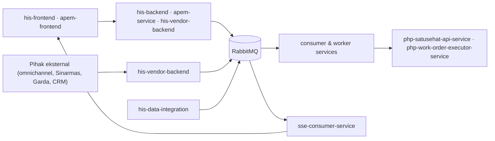

# Services under test (HISv3)

Daftar service HISv3 yang menjadi target automation test di repo ini. Sumber: registry sibling repo HISv3
(`his-v3-ai/docs/platform/sibling-repos-index.json`), disaring ke repo yang **berisi kode aplikasi dan punya runtime surface**.
Satu service = satu entri di `config/targets.ts` + `src/<kind>/<service>` + `tests/<kind>/<service>`
(lihat [multi-service-collaboration.md](multi-service-collaboration.md)).

> **Status: menunggu review.** Daftar ini diusulkan; hapus baris yang tidak dibutuhkan sebelum scaffold dibuat.

| #   | Repo                                  | Surface                                    | Level        | Status                                                                                                                                                                                                                                                                            |
| --- | ------------------------------------- | ------------------------------------------ | ------------ | --------------------------------------------------------------------------------------------------------------------------------------------------------------------------------------------------------------------------------------------------------------------------------- |
| 1   | `his-backend`                         | GraphQL + REST + cron                      | GQL/API/MQ   | **active** (GraphQL auth + `chartmanagement`, catalog `his-backend/auth`, `his-backend/chart-management`; GraphQL `patient` + `encounter` and the REST patient/encounter routers, catalog `his-backend/patient-registration`; cron SIP, catalog `his-backend/sip-report-monthly`) |
| 2   | `his-frontend`                        | Web UI                                     | WEB/E2E      | **active** (login/session + `/chart-management`, catalog `his-backend/auth`, `his-backend/chart-management`)                                                                                                                                                                      |
| 3   | `his-vendor-backend`                  | REST (omnichannel, Sinarmas, kiosk, VTT)   | API          | **active** (catalog `vendor-backend/`)                                                                                                                                                                                                                                            |
| 4   | `service-hisv3-for-primayaapp`        | GraphQL (gqlgen), backend aplikasi Primaya | GQL          | scaffold-only                                                                                                                                                                                                                                                                     |
| 5   | `his-data-integration`                | REST (CIS/CCM/LAB/transformer/EIS/…)       | API          | **active** (transformer `check-sync-data` only, catalog `data-integration/transformer-sync`; other routes **active** (transformer `check-sync-data` only, catalog `data-integration/transformer-sync`; other routes scaffold-only))                                               |
| 6   | `php-satusehat-api-service`           | REST (Slim)                                | API          | scaffold-only                                                                                                                                                                                                                                                                     |
| 7   | `php-work-order-executor-service`     | REST (Slim)                                | API          | scaffold-only                                                                                                                                                                                                                                                                     |
| 8   | `apem-service`                        | GraphQL + WebSocket                        | GQL          | scaffold-only                                                                                                                                                                                                                                                                     |
| 9   | `apem-frontend`                       | Web UI                                     | WEB          | scaffold-only                                                                                                                                                                                                                                                                     |
| 10  | `sse-consumer-service`                | SSE stream (RabbitMQ → SSE)                | API (stream) | scaffold-only                                                                                                                                                                                                                                                                     |
| 11  | `golang-websocker-server-apm-printer` | WebSocket                                  | API (ws)     | scaffold-only                                                                                                                                                                                                                                                                     |
| 12  | `audio-playback-engine`               | REST kecil + RabbitMQ                      | API/MQ       | scaffold-only                                                                                                                                                                                                                                                                     |
| 13  | `accounting-consumer-service`         | RabbitMQ consumer                          | MQ           | scaffold-only                                                                                                                                                                                                                                                                     |
| 14  | `email-publisher-service`             | RabbitMQ consumer (SMTP)                   | MQ           | **active** (lampiran e-mail, catalog `his-backend/sip-report-monthly`)                                                                                                                                                                                                            |
| 15  | `gateway-consumer-service`            | RabbitMQ consumer                          | MQ           | scaffold-only                                                                                                                                                                                                                                                                     |
| 16  | `his-data-consumer-service`           | RabbitMQ consumer                          | MQ           | scaffold-only                                                                                                                                                                                                                                                                     |
| 17  | `log-consumer-service`                | RabbitMQ consumer                          | MQ           | scaffold-only                                                                                                                                                                                                                                                                     |
| 18  | `number-generator-consumer-service`   | RabbitMQ consumer                          | MQ           | scaffold-only                                                                                                                                                                                                                                                                     |
| 19  | `whatsapp-consumer-service`           | RabbitMQ consumer                          | MQ           | scaffold-only                                                                                                                                                                                                                                                                     |
| 20  | `work-order-consumer-service`         | RabbitMQ consumer                          | MQ           | scaffold-only                                                                                                                                                                                                                                                                     |
| 21  | `virtual-printer-service`             | RabbitMQ worker                            | MQ           | scaffold-only                                                                                                                                                                                                                                                                     |
| 22  | `golang-his-cdc-service`              | DB change-data-capture worker              | MQ/DB        | scaffold-only                                                                                                                                                                                                                                                                     |
| 23  | `temp-table-generator-service`        | Batch job                                  | DB           | scaffold-only                                                                                                                                                                                                                                                                     |

Fitur produk per service (modul → sub-modul → fitur, status rilis, dan cakupan test) ada di
[modules/README.md](modules/README.md); daftar ini hanya menyatakan service mana yang sudah punya spec.

Level: `API` REST · `GQL` GraphQL · `WEB` UI · `E2E` lintas service · `MQ` publish ke RabbitMQ lalu assert efek samping
(DB/MinIO/stub keluar) · `DB` assert efek samping di database.

## Sengaja tidak masuk

| Repo                                                                                                       | Alasan                                                    |
| ---------------------------------------------------------------------------------------------------------- | --------------------------------------------------------- |
| `his-go-modules`                                                                                           | deprecated (pkg/ sudah pindah ke `his-backend/pkg`)       |
| `common-go-modules`                                                                                        | library, tidak ada runtime surface                        |
| `shlink`, `hisv3-release-notes`, `release-note-latex`                                                      | infra / dokumentasi, bukan kode produk                    |
| `satusehat-consumer-service`, `shortener-url-consumer-service`, `his-transformer`, `ccp-scheduler-service` | ada di registry tetapi belum di-clone → belum bisa dikaji |

## Alur (ringkas)

