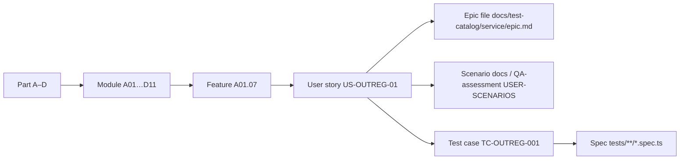

# HISv3 module catalogue

The **single source of truth** for what HISv3 does: Part → Module → Sub-module → Feature, with the release status of every
feature. The [test catalog](../test-catalog/README.md) hangs off it — every user story names the feature(s) it serves, so the
whole chain is one connected graph:

| Fact                                                                                                                            | Lives only in                                                           |
| ------------------------------------------------------------------------------------------------------------------------------- | ----------------------------------------------------------------------- |
| Feature id, name, repo, release status, `Status as of`, evidence                                                                | the feature row in `[A-D]-*.md`                                         |
| Story ↔ feature link                                                                                                            | the user-story line of the epic file: `- **US-X-01** ([A01.07](…)) — …` |
| Test case, status, spec                                                                                                         | the test-case row of the epic file                                      |
| Per-feature coverage, [traceability.md](traceability.md), [unmapped-stories.md](unmapped-stories.md), summary and backlog below | **generated** by `npm run catalog:report`                               |

Source: reverse-engineered catalogue `HISV3-MODULE-CATALOGUE.md` (owner review 2026-11-10, update 2026-11-11) from the
Google Sheet Gantt, `hisv3-release-notes/2026`, the `main`/`staging` branches of the product repos and the HISv3 BRD. That file
is superseded by this folder; change the product map here.

## How to use it

- **Product changes** (new feature, status moves to `PROD`): edit the feature row by hand; keep the id stable, never reuse
  one. Set `Status as of` to the day the status was confirmed. A compound feature may get child rows `A01.07.01` when a test
  needs a finer target; the parent row stays.
- **New user story**: put the feature id(s) on the story line (`- **US-X-01** (A01.07) — …`); `npm run catalog:report`
  turns the ids into links. A story that serves no catalogue feature says `(unmapped: <why>)`.
- **Validate / refresh**: `npm run catalog` (ids, statuses, dates, links) and `npm run catalog:report` (all generated blocks).
- **Next automation target**: the `DEV-DONE` and `PROD` features in [Automation backlog](#automation-backlog).

## Legend

`Status as of` (column added in the automation repo, 2026-11-12): for `PROD` = "in production as of this date"; for
`DEV-DONE` = "development done, not yet used by end users in production, as of this date"; `—` for the other statuses.
Columns `Epics`, `Stories`, `TCs`, `Automated` of the module files are generated from the test catalog.

### Release status (Legenda Status)

| Kode | Status        | Arti                                                                         | Bukti utama                                                                                                                         |
| ---- | ------------- | ---------------------------------------------------------------------------- | ----------------------------------------------------------------------------------------------------------------------------------- |
| 🟢   | `PROD`        | 100% selesai & sudah dipakai di production                                   | sheet: `% DONE` 100% **hijau**; atau release note prod (✅); atau kode ada di `main` (aturan owner: di `main` = sudah dipakai user) |
| 🔵   | `DEV-DONE`    | Dev selesai, belum ACK end-user / masih uji QC internal (umumnya di staging) | sheet: 100% **biru** (kode sudah naik tetapi belum dipakai user); atau kode hanya di `staging`                                      |
| 🟡   | `IN-PROGRESS` | Sebagian selesai / sedang dikerjakan                                         | sheet: 0% < nilai < 100%, atau campuran                                                                                             |
| ⚪   | `NOT-STARTED` | Terdaftar tetapi belum dimulai / belum ada kode                              | sheet 0% tanpa warna & tidak ada kode                                                                                               |
| ❔   | `UNKNOWN`     | Tidak ada bukti cukup                                                        | —                                                                                                                                   |

**Tag Evidence:** `S:<WBS>` = baris Google Sheet Gantt (detail di [`_source/sheet-extract.csv`](_source/sheet-extract.csv)) · `RN:<yyyymmdd>` = file di `hisv3-release-notes/2026` · `GIT:main` = ada di branch main · `GIT:stg` = hanya di staging · `BRD:D<n>` = domain ke-n di `BRD-his-v3.md` §10.1 · baris tanpa tag `S:`/`RN:` hanya berbasis `GIT:main` — status `PROD` dikonfirmasi owner (aturan: di `main` = dipakai), kecuali sheet biru.

**Aturan gabungan:** hijau semua → PROD; ada biru → DEV-DONE; campuran → status terendah dengan rincian di _Catatan_. Bila release note menyatakan rilis tetapi sheet masih biru, **release note terbaru menang** (aturan owner). Sheet biru + kode di `main` = kode naik tetapi belum dipakai user (`DEV-DONE`).

## Summary

<!-- modules-summary:start -->

| Part                  | `PROD` | `DEV-DONE` | `IN-PROGRESS` | `NOT-STARTED` | `UNKNOWN` | Features | With stories | With automation |
| --------------------- | -----: | ---------: | ------------: | ------------: | --------: | -------: | -----------: | --------------: |
| [A](A-core.md)        |    336 |         17 |             8 |            12 |         1 |      374 |           22 |              10 |
| [B](B-vendor.md)      |     10 |         12 |             1 |             1 |         0 |       24 |           23 |               6 |
| [C](C-primaya-app.md) |      6 |          0 |             1 |             0 |         0 |        7 |            0 |               0 |
| [D](D-corporate.md)   |     17 |          4 |            10 |             8 |         0 |       39 |           25 |               1 |
| **Total**             |    369 |         33 |            20 |            21 |         1 |      444 |           70 |              17 |

<!-- modules-summary:end -->

## Modules

- [Part A — Core HIS platform (his-backend + his-frontend)](A-core.md)
  - [A01 — Registrasi, Pasien & Kunjungan](A-core.md#a01) (18)
  - [A02 — Antrian & Tampilan Publik](A-core.md#a02) (3)
  - [A03 — Pelayanan Klinis per Jenis Kunjungan](A-core.md#a03) (16)
  - [A04 — Rekam Medis Elektronik (EMR)](A-core.md#a04) (16)
  - [A05 — Farmasi](A-core.md#a05) (8)
  - [A06 — Billing, Kasir, Paket & Payor](A-core.md#a06) (15)
  - [A07 — Laboratorium](A-core.md#a07) (7)
  - [A08 — Radiologi](A-core.md#a08) (4)
  - [A09 — Inventory, Gudang & Pembelian](A-core.md#a09) (23)
  - [A10 — Approval / Persetujuan](A-core.md#a10) (2)
  - [A11 — Mutu, Laporan & Analitik](A-core.md#a11) (6)
  - [A12 — Master Data & Tarif](A-core.md#a12) (11)
  - [A13 — Akses, Hak Akses & Pengguna](A-core.md#a13) (7)
  - [A14 — Integrasi Eksternal (sisi core)](A-core.md#a14) (15)
  - [A15 — Form Klinis dan Administratif](A-core.md#a15) (69)
  - [A16 — Surat Keterangan (SK)](A-core.md#a16) (15)
  - [A17 — Cetakan Laporan](A-core.md#a17) (134)
  - [A18 — Radioterapi (Radiotherapy Information System)](A-core.md#a18) (1)
  - [A19 — RIS (Radiology Information System)](A-core.md#a19) (1)
  - [A20 — Radio Nuklir (RN)](A-core.md#a20) (3)
- [Part B — Omni-channel & vendor integration (his-vendor-backend)](B-vendor.md)
  - [B01 — Omnichannel — Inquiry & Registrasi](B-vendor.md#b01) (2)
  - [B02 — Omnichannel — Booking](B-vendor.md#b02) (3)
  - [B03 — Integrasi Asuransi](B-vendor.md#b03) (2)
  - [B04 — Kiosk HIS v2](B-vendor.md#b04) (9)
  - [B05 — VTT — Dictation to EMR](B-vendor.md#b05) (5)
  - [B06 — Teknis & Monitoring (his-vendor-backend)](B-vendor.md#b06) (3)
- [Part C — Primaya mobile app (service-hisv3-for-primayaapp)](C-primaya-app.md)
  - [C01 — API Aplikasi Mobile Primaya (`/app`)](C-primaya-app.md#c01) (7)
- [Part D — Corporate & web platform (his-data-integration, CCP, CRM, CIS, CCM, …)](D-corporate.md)
  - [D01 — CIS & CCM (master korporat → HIS)](D-corporate.md#d01) (6)
  - [D02 — CCP (Central Purchasing)](D-corporate.md#d02) (4)
  - [D03 — CRM (Primaya LMS)](D-corporate.md#d03) (9)
  - [D04 — EIS](D-corporate.md#d04) (1)
  - [D05 — ESI (CCD) & CCA — Corporate Platform](D-corporate.md#d05) (2)
  - [D06 — AIS (Akuntansi)](D-corporate.md#d06) (1)
  - [D07 — Hardware & Alat Lab](D-corporate.md#d07) (3)
  - [D08 — Westerindo dan Sistem Approval](D-corporate.md#d08) (2)
  - [D09 — Transformer & Single Medrec (Datalake)](D-corporate.md#d09) (1)
  - [D10 — Mutu, Jadwal Dokter, Master Data, Public](D-corporate.md#d10) (5)
  - [D11 — BPJS](D-corporate.md#d11) (4)
  - [D12 — OnePage App (healthcare-one-page-app → his-data-integration)](D-corporate.md#d12) (1)

## Automation backlog

<!-- modules-backlog:start -->

30 `DEV-DONE` and 355 `PROD` features have no automated case yet — the next automation targets. `DEV-DONE` features are listed one by one (a `*` marks one that already has user stories); for `PROD` the count is given (open the module to see them) and the features that already have user stories / planned cases are listed.

| Module                                                                                   | `DEV-DONE` without automation                                                                                                                                                                                                                                                  | `PROD` without automation | `PROD` without automation, stories already planned                                                      |
| ---------------------------------------------------------------------------------------- | ------------------------------------------------------------------------------------------------------------------------------------------------------------------------------------------------------------------------------------------------------------------------------ | ------------------------: | ------------------------------------------------------------------------------------------------------- |
| [A01 — Registrasi, Pasien & Kunjungan](A-core.md#a01)                                    | [A01.06](A-core.md#f-a01-06)\*                                                                                                                                                                                                                                                 |                        12 | [A01.04](A-core.md#f-a01-04), [A01.07](A-core.md#f-a01-07)                                              |
| [A02 — Antrian & Tampilan Publik](A-core.md#a02)                                         | [A02.02](A-core.md#f-a02-02)                                                                                                                                                                                                                                                   |                         2 | [A02.01](A-core.md#f-a02-01)                                                                            |
| [A03 — Pelayanan Klinis per Jenis Kunjungan](A-core.md#a03)                              |                                                                                                                                                                                                                                                                                |                        14 |                                                                                                         |
| [A04 — Rekam Medis Elektronik (EMR)](A-core.md#a04)                                      | [A04.08](A-core.md#f-a04-08)                                                                                                                                                                                                                                                   |                        14 |                                                                                                         |
| [A05 — Farmasi](A-core.md#a05)                                                           | [A05.06](A-core.md#f-a05-06)                                                                                                                                                                                                                                                   |                         7 |                                                                                                         |
| [A06 — Billing, Kasir, Paket & Payor](A-core.md#a06)                                     |                                                                                                                                                                                                                                                                                |                        14 | [A06.08](A-core.md#f-a06-08), [A06.14](A-core.md#f-a06-14)                                              |
| [A07 — Laboratorium](A-core.md#a07)                                                      |                                                                                                                                                                                                                                                                                |                         7 | [A07.04](A-core.md#f-a07-04), [A07.06](A-core.md#f-a07-06)                                              |
| [A08 — Radiologi](A-core.md#a08)                                                         |                                                                                                                                                                                                                                                                                |                         4 |                                                                                                         |
| [A09 — Inventory, Gudang & Pembelian](A-core.md#a09)                                     | [A09.10](A-core.md#f-a09-10), [A09.15](A-core.md#f-a09-15)                                                                                                                                                                                                                     |                        16 |                                                                                                         |
| [A10 — Approval / Persetujuan](A-core.md#a10)                                            |                                                                                                                                                                                                                                                                                |                         2 | [A10.02](A-core.md#f-a10-02)                                                                            |
| [A11 — Mutu, Laporan & Analitik](A-core.md#a11)                                          | [A11.03](A-core.md#f-a11-03), [A11.06](A-core.md#f-a11-06)                                                                                                                                                                                                                     |                         2 | [A11.01](A-core.md#f-a11-01)                                                                            |
| [A12 — Master Data & Tarif](A-core.md#a12)                                               | [A12.03](A-core.md#f-a12-03)                                                                                                                                                                                                                                                   |                        10 |                                                                                                         |
| [A13 — Akses, Hak Akses & Pengguna](A-core.md#a13)                                       | [A13.05](A-core.md#f-a13-05)                                                                                                                                                                                                                                                   |                         2 |                                                                                                         |
| [A14 — Integrasi Eksternal (sisi core)](A-core.md#a14)                                   | [A14.06](A-core.md#f-a14-06), [A14.13](A-core.md#f-a14-13), [A14.14](A-core.md#f-a14-14)                                                                                                                                                                                       |                         7 | [A14.01](A-core.md#f-a14-01), [A14.05](A-core.md#f-a14-05)                                              |
| [A15 — Form Klinis dan Administratif](A-core.md#a15)                                     | [A15.60](A-core.md#f-a15-60)                                                                                                                                                                                                                                                   |                        68 |                                                                                                         |
| [A16 — Surat Keterangan (SK)](A-core.md#a16)                                             |                                                                                                                                                                                                                                                                                |                        15 |                                                                                                         |
| [A17 — Cetakan Laporan](A-core.md#a17)                                                   |                                                                                                                                                                                                                                                                                |                       133 |                                                                                                         |
| [B03 — Integrasi Asuransi](B-vendor.md#b03)                                              |                                                                                                                                                                                                                                                                                |                         1 | [B03.02](B-vendor.md#f-b03-02)                                                                          |
| [B04 — Kiosk HIS v2](B-vendor.md#b04)                                                    | [B04.01](B-vendor.md#f-b04-01)\*, [B04.02](B-vendor.md#f-b04-02)\*, [B04.03](B-vendor.md#f-b04-03)\*, [B04.05](B-vendor.md#f-b04-05)\*, [B04.06](B-vendor.md#f-b04-06)\*, [B04.07](B-vendor.md#f-b04-07)\*, [B04.08](B-vendor.md#f-b04-08)\*, [B04.09](B-vendor.md#f-b04-09)\* |                         0 |                                                                                                         |
| [B05 — VTT — Dictation to EMR](B-vendor.md#b05)                                          | [B05.01](B-vendor.md#f-b05-01)\*, [B05.02](B-vendor.md#f-b05-02)\*, [B05.03](B-vendor.md#f-b05-03)\*, [B05.04](B-vendor.md#f-b05-04)\*                                                                                                                                         |                         0 |                                                                                                         |
| [B06 — Teknis & Monitoring (his-vendor-backend)](B-vendor.md#b06)                        |                                                                                                                                                                                                                                                                                |                         3 | [B06.01](B-vendor.md#f-b06-01), [B06.02](B-vendor.md#f-b06-02), [B06.03](B-vendor.md#f-b06-03)          |
| [C01 — API Aplikasi Mobile Primaya (`/app`)](C-primaya-app.md#c01)                       |                                                                                                                                                                                                                                                                                |                         6 |                                                                                                         |
| [D02 — CCP (Central Purchasing)](D-corporate.md#d02)                                     |                                                                                                                                                                                                                                                                                |                         3 | [D02.01](D-corporate.md#f-d02-01), [D02.02](D-corporate.md#f-d02-02), [D02.03](D-corporate.md#f-d02-03) |
| [D03 — CRM (Primaya LMS)](D-corporate.md#d03)                                            | [D03.04](D-corporate.md#f-d03-04)\*                                                                                                                                                                                                                                            |                         3 | [D03.01](D-corporate.md#f-d03-01), [D03.02](D-corporate.md#f-d03-02)                                    |
| [D04 — EIS](D-corporate.md#d04)                                                          | [D04.01](D-corporate.md#f-d04-01)\*                                                                                                                                                                                                                                            |                         0 |                                                                                                         |
| [D06 — AIS (Akuntansi)](D-corporate.md#d06)                                              |                                                                                                                                                                                                                                                                                |                         1 | [D06.01](D-corporate.md#f-d06-01)                                                                       |
| [D07 — Hardware & Alat Lab](D-corporate.md#d07)                                          |                                                                                                                                                                                                                                                                                |                         3 | [D07.01](D-corporate.md#f-d07-01), [D07.02](D-corporate.md#f-d07-02), [D07.03](D-corporate.md#f-d07-03) |
| [D08 — Westerindo dan Sistem Approval](D-corporate.md#d08)                               |                                                                                                                                                                                                                                                                                |                         2 | [D08.01](D-corporate.md#f-d08-01), [D08.02](D-corporate.md#f-d08-02)                                    |
| [D10 — Mutu, Jadwal Dokter, Master Data, Public](D-corporate.md#d10)                     | [D10.03](D-corporate.md#f-d10-03)\*, [D10.05](D-corporate.md#f-d10-05)\*                                                                                                                                                                                                       |                         3 | [D10.01](D-corporate.md#f-d10-01), [D10.02](D-corporate.md#f-d10-02), [D10.04](D-corporate.md#f-d10-04) |
| [D12 — OnePage App (healthcare-one-page-app → his-data-integration)](D-corporate.md#d12) |                                                                                                                                                                                                                                                                                |                         1 | [D12.01](D-corporate.md#f-d12-01)                                                                       |

<!-- modules-backlog:end -->

## Unmapped stories

User stories in the test catalog that serve no catalogue feature. The full list, with story text, test cases and the
resolution options, is in [unmapped-stories.md](unmapped-stories.md).

<!-- modules-unmapped:start -->

8 user stories serve no catalogue feature — listed for manual assessment in [unmapped-stories.md](unmapped-stories.md).

<!-- modules-unmapped:end -->

## Appendices (from the source catalogue)

### Lampiran 1 — Peta Domain BRD (`BRD-his-v3.md` §10.1) → Katalog

| #   | Domain BRD                                                                  | Modul katalog                                      |
| --- | --------------------------------------------------------------------------- | -------------------------------------------------- |
| D1  | Akses Pasien & Kanal Mandiri                                                | A02, B01, B02, B04, C01                            |
| D2  | Identitas Pasien & Rekam Medis Induk                                        | A01, D09, D12                                      |
| D3  | Kunjungan (Encounter)                                                       | A01                                                |
| D4  | Penjamin & Kepesertaan                                                      | A01, A06                                           |
| D5  | Antrian & Tampilan Publik                                                   | A02                                                |
| D6  | RME — Dokter                                                                | A04, A15, B05                                      |
| D7  | RME — Keperawatan                                                           | A04, A15                                           |
| D8  | Akses RM Lintas Unit                                                        | A04                                                |
| D9  | Pelayanan Rawat Inap                                                        | A03                                                |
| D10 | Pelayanan Gawat Darurat                                                     | A03                                                |
| D11 | Pelayanan Khusus (MCU, ODC, HD, OK, rehab, gizi, radioterapi, radio nuklir) | A03, A04, A18, A20                                 |
| D12 | Laboratorium                                                                | A07                                                |
| D13 | Radiologi                                                                   | A08, A19                                           |
| D14 | Farmasi                                                                     | A05                                                |
| D15 | Kasir, Penagihan & Pendapatan                                               | A06, A10, A20                                      |
| D16 | Rekam Medis & Dokumen                                                       | A04, A15, A16                                      |
| D17 | Inventory, Gudang & Pengadaan                                               | A09, D02                                           |
| D18 | Master Data & Tarif                                                         | A12, D10                                           |
| D19 | Tata Kelola Pengguna & Hak Akses                                            | A13                                                |
| D20 | Integrasi Eksternal                                                         | A14, B03, D01–D12                                  |
| D21 | Notifikasi & Komunikasi                                                     | A14 (WhatsApp)                                     |
| D22 | Proses Latar Belakang                                                       | — (tidak dicantumkan; bukan nilai bisnis langsung) |
| D23 | Pelaporan & Analitik                                                        | A11, A17, D10                                      |
| D24 | Monitoring Operasional                                                      | A11, D07, B06                                      |

### Lampiran 2 — Log Release Note (`hisv3-release-notes/2026`)

| File                                           | Tanggal                     | Lingkup                                                                                               | Status rilis                              |
| ---------------------------------------------- | --------------------------- | ----------------------------------------------------------------------------------------------------- | ----------------------------------------- |
| `07-Juli/20260731_SinarMas.md`                 | cut-off 07-30, target 07-31 | Integrasi Sinarmas (MinIO download, inbound biayaakhir/jawabanasuransi, UUID api log, UI cek benefit) | Parsial PHKG; **tanpa penanda ✅**        |
| `08-Agustus/20260811_Farmasi.md`               | 08-11                       | Gudang (disable create-one) + Farmasi bugfix                                                          | Cherry-pick; env tidak disebut            |
| `08-Agustus/20260813_Fix_Humpty_Dumpty.md`     | 08-13                       | Humpty Dumpty anak RI                                                                                 | Cherry-pick; sudah ✅ di RN 09-01         |
| `08-Agustus/TBA_CCAViewOnly.md`                | 08-21                       | CCA vendor/kontrak/review                                                                             | **TBA** (sheet hijau)                     |
| `08-Agustus/TBA_GudangPenempatanItem.md`       | 08-21                       | Tab Gudang Penempatan                                                                                 | **TBA** (RN 09-01 hedged)                 |
| `08-Agustus/TBA_HondokNew.md`                  | 08-21                       | Dashboard Hondok V2                                                                                   | **TBA**; V2 rilis di 09-01, bukan default |
| `09-September/20260901_Release.md`             | 09-01                       | Rilis konsolidasi PHKG (his-backend v1.27.0, FE v1.27.0, HDI v1.13.0, …)                              | **PROD** (✅)                             |
| `09-September/20260909_MiniSO.md`              | 09-09                       | Mini Stock Opname per rak                                                                             | **Staging saja**; perlu cherry-pick       |
| `09-September/20260915_SingleMedrec.md`        | 09-15                       | Single Medrec / Datalake (32 PR, 8 repo)                                                              | **Parsial**: 18 commit belum di main      |
| `11-November/20261104_Cetak_Laporan_25.md`     | 11-04                       | 25 cetak laporan + 3 PPI                                                                              | **PROD**                                  |
| `11-November/20261104_Monitoring_Satusehat.md` | 11-04                       | Monitoring Submission SatuSehat                                                                       | **PROD**                                  |

### Lampiran 3 — Sumber Sheet per Grup (ringkas)

Sumber: Google Sheet "HISV3 GANTT CHART" (sheet `Gantt Chart`), diekstrak lengkap ke [`_source/sheet-extract.csv`](_source/sheet-extract.csv) (276 task: 131 hijau, 80 biru, 65 tanpa warna). Catatan sheet sendiri: `% DONE` dipetakan dari status sumber (DEV DONE = 100%, DEV ONGOING = 50%, TODO/ON HOLD = 0%). Warna: hijau `#93C47D` = production, biru `#6D9EEB` = dev-done belum ACK/QC.

Peringatan: grup sheet "Rest api KiosK", "VTT", "InHealth RJ/RI", "Work Order", "CSSD", "EIS", "Pelaporan Kasus", "Antrian" seluruhnya biru → `DEV-DONE`.

### Lampiran 4 — Keputusan Owner (jawaban atas pertanyaan terbuka, 2026-11-10)

| #   | Topik                          | Keputusan owner                                                                                                              | Dampak pada katalog                                                                                                                         |
| --- | ------------------------------ | ---------------------------------------------------------------------------------------------------------------------------- | ------------------------------------------------------------------------------------------------------------------------------------------- |
| 1   | Konflik sheet vs release note  | Release note menang bila menyatakan rilis                                                                                    | EMR terintegrasi, multiple pengkajian, Produksi Item (CSSD) → `PROD`                                                                        |
| 2   | Kode di `main`                 | Sudah dipakai user; bila sheet masih biru = kode naik tetapi belum dipakai                                                   | Tag _inferred_ dihapus; biru tetap `DEV-DONE`                                                                                               |
| 3   | CIS / CCM                      | Masih ongoing                                                                                                                | D01 dan dashboard A14 → `IN-PROGRESS`                                                                                                       |
| 4   | Single Medrec                  | Half in production: sync regpas & medrec sudah prod; enhancement sisi HISv3 sedang diperbaiki; integrasi Transformer selesai | D10 `PROD`; dashboard/trigger/audit A14 → `IN-PROGRESS`                                                                                     |
| 5   | Sinarmas                       | Sudah dipakai di production                                                                                                  | A14 dan B03 → `PROD` (terkonfirmasi)                                                                                                        |
| 6   | InHealth & JKN Mobile          | InHealth sedang SIT; hari ini ada minor enhancement dropdown ICD-10/ICD-9. JKN Mobile milik BPJS, masih ongoing              | InHealth tetap `DEV-DONE` + baris ICD dropdown `IN-PROGRESS`; JKN Mobile (A14/C01/D12) → `IN-PROGRESS`                                      |
| 7   | EyeQ klinik mata               | Dikeluarkan dari listing; fokus HISv3                                                                                        | Baris EyeQ di A03 dihapus. 2026-11-11: PEC/EyeQ (sebagai vendor) juga dikeluarkan seluruhnya, termasuk modul D06 lama dan form/laporan EyeQ |
| 8   | ESI (CCD) & CCA                | Belum start development                                                                                                      | D05 keduanya `NOT-STARTED`                                                                                                                  |
| 9   | BPJS PCare / Vklaim / Eklaim   | Ongoing development                                                                                                          | D12 → `IN-PROGRESS` (+ baris Eklaim); kiosk BPJS `IN-PROGRESS`                                                                              |
| 10  | Menu / ACL                     | Sudah jadi, DB-driven, working well                                                                                          | A13 `PROD` terkonfirmasi                                                                                                                    |
| 11  | Kiosk                          | Selain integrasi BPJS sudah dev-done; belum dipakai user di production                                                       | B05 `DEV-DONE`, BPJS `IN-PROGRESS`                                                                                                          |
| 12  | Rollback & monitor post-commit | Ongoing; fitur internal untuk monitoring sistem                                                                              | Dikeluarkan dari katalog pada 2026-11-11 (modul Fondasi A15 lama dihapus karena tidak bernilai bisnis langsung)                             |

#### Perubahan 2026-11-11

- Dikeluarkan: PEC/EyeQ (modul D06 lama), A15 Fondasi & Proses Latar Belakang, B04 CRM Webhooks (dipindah dan diperinci di D03), B07 Operasional Vendor Backend. D09 diperkecil menjadi _Westerindo dan Sistem Approval_. ID modul dinomori ulang berurutan.
- Ditambah (NOT-STARTED): Radioterapi (RTIS), RIS, Radio Nuklir (RN). RN: future order bisa dibayar di muka (goal, masuk deposit); pada diagnostik pembayaran harus lunas dahulu agar obat bisa dipesan.
- Ditambah (sebelumnya terlewat): master hari libur, dashboard operasi, dashboard & chart builder/management, form builder & form management, form klinis/administratif, form SK, dan seluruh cetakan laporan (A15–A17).
- CRM (D03) kini rinci menurut spec: hanya `crm_deployperusahaan`, `crm_deploytarif`, `crm_deploypaket` (upsert); tidak ada undeploy. Deploy/undeploy grup layanan dan layanan ada di CIS (D01).

#### Perubahan 2026-11-12

- Ditambah 4 fitur teknis (sebelumnya dikeluarkan karena tidak bernilai bisnis langsung) agar setiap user story test catalog terpetakan: modul **B06 Teknis & Monitoring** (`B06.01` liveness `/service-status`, `B06.02` Swagger UI, `B06.03` router 404/405) dan modul **D12 OnePage App** (`D12.01` verifikasi kontak via token social media). Status `PROD` per 2026-11-12 (kode di `main`).

**Pertanyaan tersisa:** modul **CCA view-only di core** (A14, `cca_*` 13 tabel, sheet CCA-001 hijau, RN 08-21 masih TBA) bertentangan dengan jawaban #8 jika yang dimaksud "CCA" sama. Dibiarkan `PROD` sesuai sheet — mohon konfirmasi apakah dipakai user.
