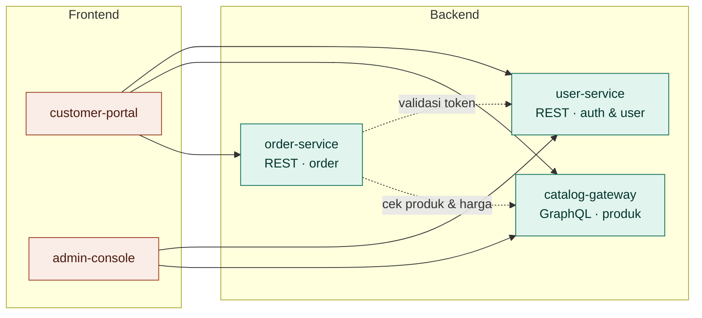
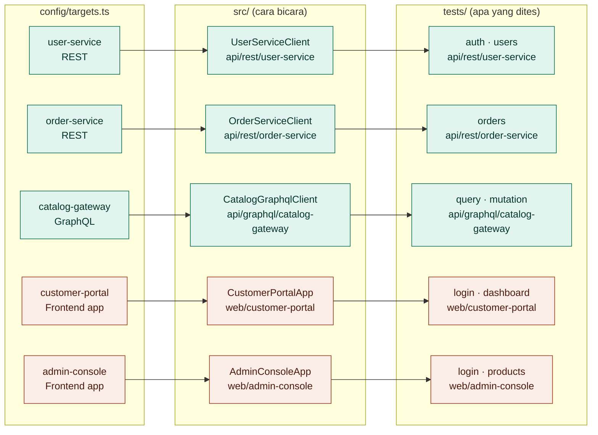
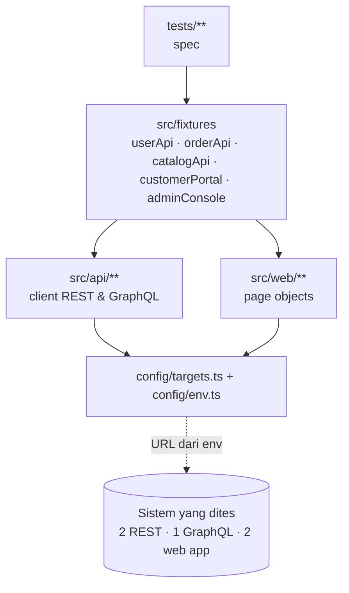
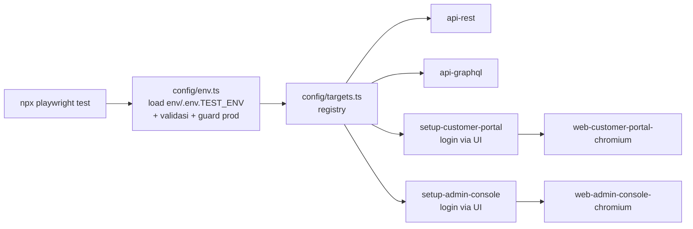
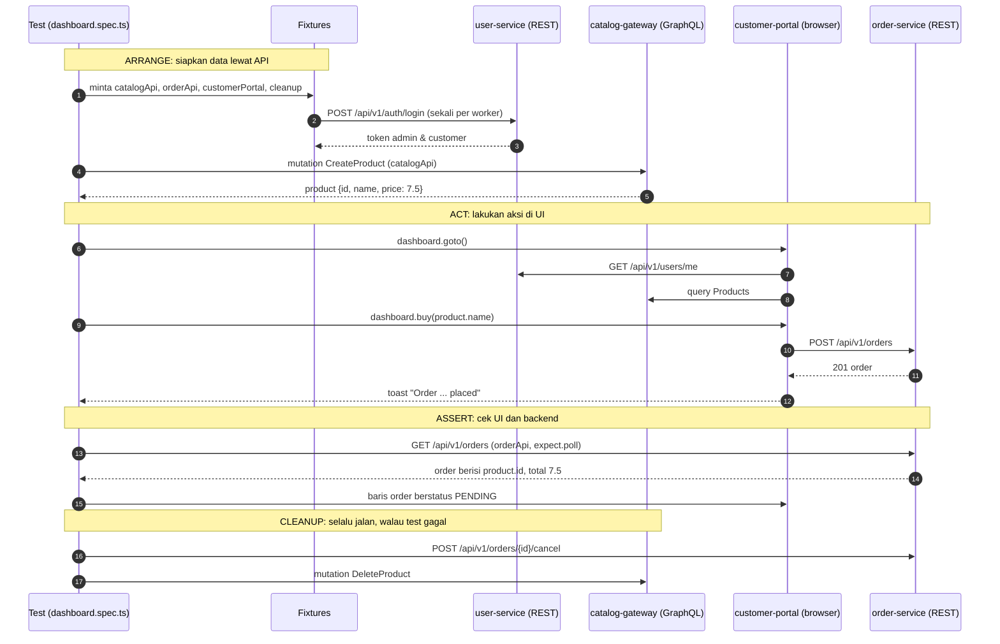
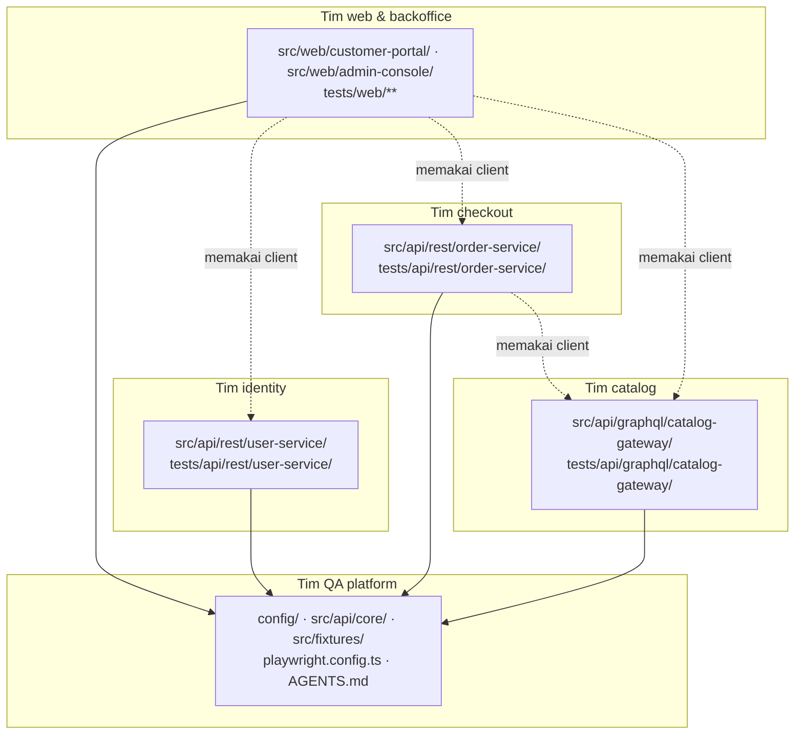
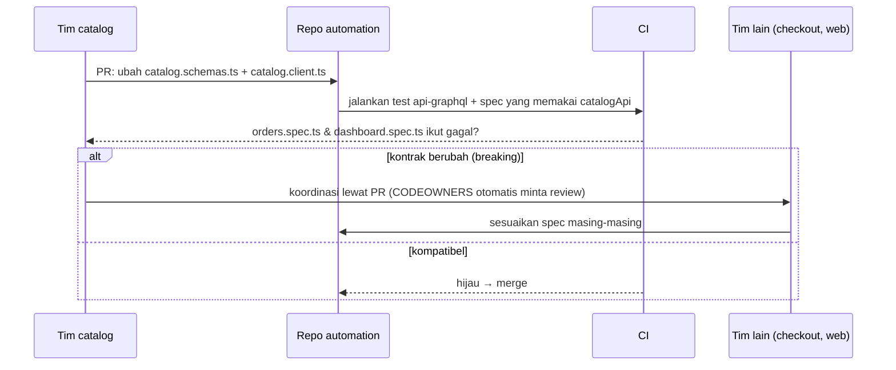

# Kolaborasi antar service: contoh 2 REST API + 1 GraphQL + 2 frontend app

> **Catatan (HISv3):** nama service/app di dokumen ini (`user-service`, `order-service`, `catalog-gateway`, `customer-portal`, `admin-console`) adalah _contoh fiktif_ dari template awal untuk menjelaskan pola; implementasinya sudah dihapus dan `mock-server/` tidak ada lagi. Service HISv3 yang sebenarnya: [hisv3-services.md](hisv3-services.md).

Dokumen ini menjelaskan bagaimana struktur repo ini menangani produk dengan **banyak service dan banyak frontend app**,
bagaimana satu test bisa melibatkan beberapa service sekaligus, dan bagaimana tim-tim pemilik service berkolaborasi di repo yang sama.

Contoh yang dipakai adalah isi template ini sendiri, jadi setiap file yang disebut bisa langsung dibuka.

> Diagram ditulis dengan [Mermaid](https://mermaid.js.org/) dan otomatis tampil sebagai gambar di GitHub, GitLab,
> dan VS Code (dengan ekstensi Markdown Preview Mermaid Support).

## Daftar isi

1. [Produk contoh](#1-produk-contoh)
2. [Prinsip: satu target = registry + src + tests](#2-prinsip-satu-target--registry--src--tests)
3. [Struktur folder](#3-struktur-folder)
4. [Lapisan demi lapisan](#4-lapisan-demi-lapisan)
5. [Alur saat test dijalankan](#5-alur-saat-test-dijalankan)
6. [Kolaborasi antar service di dalam test](#6-kolaborasi-antar-service-di-dalam-test)
7. [Tutorial: menulis test lintas service](#7-tutorial-menulis-test-lintas-service)
8. [Tutorial: menambah REST service ke-3](#8-tutorial-menambah-rest-service-ke-3-payment-service)
9. [Tutorial: menambah frontend app ke-3](#9-tutorial-menambah-frontend-app-ke-3-merchant-portal)
10. [Kolaborasi antar tim](#10-kolaborasi-antar-tim)
11. [Menjalankan per bagian](#11-menjalankan-per-bagian)
12. [Checklist](#12-checklist)

---

## 1. Produk contoh

| Jenis       | Nama di template  | Peran (contoh)                | Env var               |
| ----------- | ----------------- | ----------------------------- | --------------------- |
| REST API #1 | `user-service`    | login dan manajemen user      | `USER_SERVICE_URL`    |
| REST API #2 | `order-service`   | membuat dan membatalkan order | `ORDER_SERVICE_URL`   |
| GraphQL     | `catalog-gateway` | data produk                   | `CATALOG_GRAPHQL_URL` |
| Frontend #1 | `customer-portal` | web untuk customer            | `CUSTOMER_PORTAL_URL` |
| Frontend #2 | `admin-console`   | web untuk admin               | `ADMIN_CONSOLE_URL`   |

Gambaran arsitektur produk yang dites (contoh). Frontend memanggil beberapa backend, dan backend saling bergantung:



Karena service saling bergantung, bug paling sering muncul **di sambungan antar service**. Struktur ini dibuat supaya
sambungan itu mudah dites.

---

## 2. Prinsip: satu target = registry + src + tests

Setiap service atau app punya **tiga hal dengan nama yang sama**:

1. satu entri di **registry** (`config/targets.ts`),
2. satu folder di **`src/`**: cara berkomunikasi dengannya (client API atau page object),
3. satu folder di **`tests/`**: apa yang dites.



Hijau = backend (REST, GraphQL), oranye = frontend.

Aturan arah ketergantungan (hanya boleh ke bawah):



Spec tidak pernah menulis URL, `request.get()` mentah, atau selector mentah. Semuanya lewat client dan page object.

---

## 3. Struktur folder

Label `[REST-1]`, `[REST-2]`, `[GQL]`, `[FE-1]`, `[FE-2]` menunjukkan target pemilik folder.

```text
config/
├── env.ts                         # 5 URL divalidasi di sini (zod)
└── targets.ts                     # registry: 2 REST + 1 GraphQL + 2 app

src/
├── api/
│   ├── core/                      # dipakai bersama: BaseApiClient, GraphqlClient, expectJson()
│   ├── rest/
│   │   ├── user-service/          [REST-1]
│   │   │   ├── user-service.client.ts      ← 1 method = 1 endpoint
│   │   │   └── user-service.schemas.ts     ← kontrak response (zod)
│   │   └── order-service/         [REST-2]
│   │       ├── order-service.client.ts
│   │       └── order-service.schemas.ts
│   └── graphql/
│       └── catalog-gateway/       [GQL]
│           ├── catalog.client.ts           ← products(), createProduct(), ...
│           ├── catalog.operations.ts       ← query/mutation GraphQL
│           └── catalog.schemas.ts
├── web/
│   ├── shared/base.page.ts        # dipakai bersama semua app
│   ├── customer-portal/           [FE-1]
│   │   ├── customer-portal.app.ts          ← pintu masuk app (kumpulan page)
│   │   ├── pages/login.page.ts, dashboard.page.ts
│   │   └── components/header.component.ts
│   └── admin-console/             [FE-2]
│       ├── admin-console.app.ts
│       └── pages/login.page.ts, products.page.ts
├── fixtures/
│   ├── api.fixtures.ts            # userApi, orderApi, catalogApi, apiContextFor, cleanup
│   ├── web.fixtures.ts            # customerPortal, adminConsole
│   └── index.ts                   # digabung → satu `test`
└── data/factories/                # buildUser(), buildProduct()

tests/
├── api/rest/user-service/         [REST-1]  auth.spec.ts, users.spec.ts
├── api/rest/order-service/        [REST-2]  orders.spec.ts
├── api/graphql/catalog-gateway/   [GQL]     products.query.spec.ts, products.mutation.spec.ts
├── web/customer-portal/           [FE-1]    login.spec.ts, dashboard.spec.ts
├── web/admin-console/             [FE-2]    login.spec.ts, products.spec.ts
└── setup/                                   customer-portal.setup.ts, admin-console.setup.ts
```

---

## 4. Lapisan demi lapisan

### 4.1 URL di file env

Satu variabel per target. Nilainya beda untuk local dan staging, **nama variabelnya sama**.

```dotenv
# env/.env.staging  (git-ignored; template: env/.env.staging.example)
USER_SERVICE_URL=https://api.staging.example.com/user-service
ORDER_SERVICE_URL=https://api.staging.example.com/order-service
CATALOG_GRAPHQL_URL=https://graphql.staging.example.com/graphql
CUSTOMER_PORTAL_URL=https://portal.staging.example.com
ADMIN_CONSOLE_URL=https://admin.staging.example.com
```

### 4.2 Registry: `config/targets.ts`

Satu-satunya tempat yang tahu ada service dan app apa saja.

```ts
export const restServices = {
  'user-service': { baseURL: env.USER_SERVICE_URL },
  'order-service': { baseURL: env.ORDER_SERVICE_URL },
};

export const graphqlEndpoints = {
  'catalog-gateway': { url: env.CATALOG_GRAPHQL_URL },
};

export const webApps = [
  {
    name: 'customer-portal',
    baseURL: env.CUSTOMER_PORTAL_URL,
    storageState: '.auth/customer-portal.json',
    role: 'customer',
  },
  { name: 'admin-console', baseURL: env.ADMIN_CONSOLE_URL, storageState: '.auth/admin-console.json', role: 'admin' },
];
```

### 4.3 `src/`: cara bicara dengan tiap target

| Jenis    | Isi folder                                               | Contoh pemakaian                                            |
| -------- | -------------------------------------------------------- | ----------------------------------------------------------- |
| REST     | `<service>.client.ts` + `<service>.schemas.ts`           | `await orderApi.createOrder({ items: [...] })`              |
| GraphQL  | `<x>.client.ts` + `<x>.operations.ts` + `<x>.schemas.ts` | `await catalogApi.createProduct({ name, price, category })` |
| Frontend | `<app>.app.ts` + `pages/` + `components/`                | `await customerPortal.dashboard.buy('Kopi')`                |

Client REST hanya memetakan endpoint, tanpa assertion:

```ts
// src/api/rest/order-service/order-service.client.ts
createOrder(body: NewOrder): Promise<APIResponse> {
  return this.post('/api/v1/orders', { data: body });
}
```

App object frontend mengumpulkan semua page milik app itu:

```ts
// src/web/customer-portal/customer-portal.app.ts
export class CustomerPortalApp {
  readonly login: CustomerLoginPage;
  readonly dashboard: DashboardPage;
}
```

### 4.4 Fixtures: penghubung

Test tinggal menyebut apa yang dibutuhkan. Client sudah terpasang dengan URL dan token login yang benar.

| Fixture          | Isi                                                                   | Login sebagai    |
| ---------------- | --------------------------------------------------------------------- | ---------------- |
| `userApi`        | `UserServiceClient`                                                   | admin            |
| `orderApi`       | `OrderServiceClient`                                                  | customer         |
| `catalogApi`     | `CatalogGraphqlClient`                                                | admin            |
| `apiContextFor`  | buat client dengan role lain (`'anonymous'`, `'customer'`, `'admin'`) | sesuai parameter |
| `customerPortal` | `CustomerPortalApp` (sudah login lewat storageState)                  | customer         |
| `adminConsole`   | `AdminConsoleApp` (sudah login lewat storageState)                    | admin            |
| `cleanup`        | `cleanup.add(fn)`: hapus data setelah test, walau test gagal          | –                |

```ts
test('...', async ({ userApi, orderApi, catalogApi, customerPortal, adminConsole, cleanup }) => {
  /* ... */
});
```

> Token semua fixture API didapat dari **user-service** (`POST /api/v1/auth/login`) sekali per worker.
> Artinya user-service otomatis ikut dites setiap kali test service lain berjalan.

### 4.5 Playwright project: dibentuk otomatis dari registry

```text
api-rest                         → tests/api/rest/   (user-service + order-service)
api-graphql                      → tests/api/graphql/
setup-customer-portal            → login customer sekali, simpan .auth/customer-portal.json
web-customer-portal-chromium     → tests/web/customer-portal/
setup-admin-console              → login admin sekali, simpan .auth/admin-console.json
web-admin-console-chromium       → tests/web/admin-console/
```

---

## 5. Alur saat test dijalankan



1. `TEST_ENV` (default `local`) memilih file env. Env var dari CI selalu menang atas isi file.
2. Konfigurasi divalidasi. Kalau ada URL yang hilang atau mengarah ke production, run langsung berhenti.
3. Registry membentuk project. Project API jalan tanpa browser.
4. Project `setup-<app>` login sekali lewat UI dan menyimpan session. Semua test web app itu memakai session tersebut.
5. Test berjalan paralel. Setiap test membuat datanya sendiri (nama unik berawalan `e2e-`) dan membersihkannya lewat `cleanup`.

---

## 6. Kolaborasi antar service di dalam test

### 6.1 Tiga level test untuk produk multi-service

| Level                     | Yang dites                                                 | Contoh di repo                                        | Service yang terlibat           |
| ------------------------- | ---------------------------------------------------------- | ----------------------------------------------------- | ------------------------------- |
| 1. Per service (kontrak)  | Satu service sendirian: status, kontrak, auth, validasi    | `users.spec.ts`, `products.query.spec.ts`             | 1 (+ user-service untuk token)  |
| 2. Lintas service via API | Data dari service A dipakai service B                      | `orders.spec.ts`                                      | catalog-gateway → order-service |
| 3. Frontend ke backend    | Aksi user di UI menghasilkan perubahan di beberapa service | `dashboard.spec.ts`, `admin-console/products.spec.ts` | UI + 2–3 backend                |

Makin tinggi level, makin sedikit jumlah test-nya tapi makin besar nilainya untuk menemukan bug di sambungan.

### 6.2 Matriks: spec mana memakai service mana

| Spec                                             | user-service | order-service | catalog-gateway | customer-portal | admin-console |
| ------------------------------------------------ | :----------: | :-----------: | :-------------: | :-------------: | :-----------: |
| `api/rest/user-service/auth.spec.ts`             |      ●       |               |                 |                 |               |
| `api/rest/user-service/users.spec.ts`            |      ●       |               |                 |                 |               |
| `api/rest/order-service/orders.spec.ts`          |   ○ token    |       ●       |     ○ seed      |                 |               |
| `api/graphql/catalog-gateway/products.*.spec.ts` |   ○ token    |               |        ●        |                 |               |
| `web/customer-portal/login.spec.ts`              |   ○ via UI   |               |                 |        ●        |               |
| `web/customer-portal/dashboard.spec.ts`          |      ○       | ○ verifikasi  |     ○ seed      |        ●        |               |
| `web/admin-console/login.spec.ts`                |   ○ via UI   |               |                 |                 |       ●       |
| `web/admin-console/products.spec.ts`             |   ○ token    |               |  ○ verifikasi   |                 |       ●       |

● = target utama yang dites (lokasi folder spec). ○ = service pendukung (seed data, token, atau verifikasi).

### 6.3 Contoh alur: "customer membeli produk dari UI"

Test: `tests/web/customer-portal/dashboard.spec.ts` → `buying in the UI creates an order in order-service`.



Satu test ini sekaligus membuktikan bahwa:

- customer-portal bisa membaca user (user-service) dan katalog (catalog-gateway),
- order dari UI benar-benar tersimpan di order-service dengan harga dari catalog-gateway,
- tampilan UI cocok dengan data di backend.

---

## 7. Tutorial: menulis test lintas service

Pola standar: **arrange via API → act di UI (atau service lain) → assert di UI dan via API → cleanup.**

**Langkah 1: tentukan target utama dan lokasi file.** Perilaku yang dites adalah "membeli dari dashboard" milik
customer-portal, jadi file-nya `tests/web/customer-portal/dashboard.spec.ts`.

**Langkah 2: import dari `@fixtures`, ambil fixture yang dibutuhkan.**

```ts
import { test, expect } from '@fixtures';
import { expectJson } from '@api/core/assertions';
import { OrderListSchema } from '@api/rest/order-service/order-service.schemas';
import { buildProduct } from '@data/factories/product.factory';
import { Tag } from '@utils/tags';

test('buying in the UI creates an order in order-service', { tag: [Tag.regression] }, async ({
  customerPortal, // FE-1
  catalogApi, //     GraphQL
  orderApi, //       REST-2
  cleanup,
}) => {
```

**Langkah 3: arrange lewat API dan langsung daftarkan cleanup.** Jangan menyiapkan data lewat UI kalau ada API-nya,
karena API lebih cepat dan stabil.

```ts
const product = await catalogApi.createProduct(buildProduct({ price: 7.5 }));
cleanup.add(() => catalogApi.deleteProduct(product.id));
```

**Langkah 4: act di UI lewat page object.**

```ts
await customerPortal.dashboard.goto();
await customerPortal.dashboard.buy(product.name);
await expect(customerPortal.dashboard.toast).toHaveText(/^Order .+ placed$/);
```

**Langkah 5: assert di backend.** UI bisa saja menampilkan "sukses" padahal data tidak tersimpan. Gunakan
`expect.poll`, bukan sleep, karena backend sering _eventually consistent_.

```ts
  const findOrder = async () => {
    const { data } = await expectJson(await orderApi.listMyOrders(), OrderListSchema);
    return data.find((o) => o.items.some((item) => item.productId === product.id));
  };
  await expect.poll(findOrder, { message: 'order should exist in order-service' }).toBeDefined();
  const order = (await findOrder())!;
  cleanup.add(() => orderApi.cancelOrder(order.id));

  expect(order.total).toBe(7.5);
  await expect(customerPortal.dashboard.orderRow(order.id)).toContainText('PENDING');
});
```

**Langkah 6: jalankan 3× untuk memastikan stabil.**

```bash
npx playwright test tests/web/customer-portal/dashboard.spec.ts --repeat-each=3
```

Variasi lintas service murni lewat API (tanpa UI) ada di `tests/api/rest/order-service/orders.spec.ts`:
produk dibuat lewat GraphQL, lalu order dibuat lewat order-service, lalu total dicek.

---

## 8. Tutorial: menambah REST service ke-3 (`payment-service`)

**Langkah 1: env var.** Tambahkan ke schema `config/env.ts` dan ke **kedua** file `env/*.example`.

```ts
// config/env.ts → di dalam z.object({...})
PAYMENT_SERVICE_URL: z.url(),
```

```dotenv
# env/.env.local.example
PAYMENT_SERVICE_URL=http://localhost:4004
# env/.env.staging.example
PAYMENT_SERVICE_URL=https://api.staging.example.com/payment-service
```

**Langkah 2: registry.**

```ts
// config/targets.ts
export const restServices = {
  'user-service': { baseURL: env.USER_SERVICE_URL },
  'order-service': { baseURL: env.ORDER_SERVICE_URL },
  'payment-service': { baseURL: env.PAYMENT_SERVICE_URL }, // ← baru
} as const satisfies Record<string, { baseURL: string }>;
```

**Langkah 3: schema dan client** di `src/api/rest/payment-service/`.

```ts
// payment-service.schemas.ts
import { z } from 'zod';

export const PaymentSchema = z.object({
  id: z.string().min(1),
  orderId: z.string().min(1),
  status: z.enum(['PENDING', 'SUCCEEDED', 'FAILED']),
  amount: z.number().nonnegative(),
});
export type NewPayment = { orderId: string; method: 'card' | 'va' };
```

```ts
// payment-service.client.ts
import type { APIRequestContext, APIResponse } from '@playwright/test';
import { restServices } from '@config/targets';
import { BaseApiClient } from '@api/core/base-api-client';
import type { NewPayment } from './payment-service.schemas';

export class PaymentServiceClient extends BaseApiClient {
  constructor(request: APIRequestContext, baseURL: string = restServices['payment-service'].baseURL) {
    super(request, baseURL);
  }

  createPayment(body: NewPayment): Promise<APIResponse> {
    return this.post('/api/v1/payments', { data: body });
  }

  getPayment(id: string): Promise<APIResponse> {
    return this.get(`/api/v1/payments/${encodeURIComponent(id)}`);
  }
}
```

**Langkah 4: fixture** di `src/fixtures/api.fixtures.ts`.

```ts
export interface ApiFixtures {
  // ...
  paymentApi: PaymentServiceClient; // ← baru
}

// di dalam base.extend({...})
paymentApi: async ({ apiContextFor }, use) => {
  await use(new PaymentServiceClient(await apiContextFor('customer')));
},
```

**Langkah 5: test** di `tests/api/rest/payment-service/`. Mulai dari kontrak per service, lalu tambahkan alur
lintas service (order-service → payment-service):

```ts
// tests/api/rest/payment-service/payments.spec.ts
test(
  'paying a pending order marks the payment SUCCEEDED',
  { tag: [Tag.smoke] },
  async ({ catalogApi, orderApi, paymentApi, cleanup }) => {
    const product = await catalogApi.createProduct(buildProduct({ price: 20 }));
    cleanup.add(() => catalogApi.deleteProduct(product.id));
    const order = await expectJson(
      await orderApi.createOrder({ items: [{ productId: product.id, quantity: 1 }] }),
      OrderSchema,
      201,
    );
    cleanup.add(() => orderApi.cancelOrder(order.id));

    const payment = await expectJson(
      await paymentApi.createPayment({ orderId: order.id, method: 'card' }),
      PaymentSchema,
      201,
    );

    expect(payment.amount).toBe(order.total);
  },
);
```

**Langkah 6: ownership.** Tambahkan baris di `.github/CODEOWNERS`:

```text
/src/api/rest/payment-service/     @developersismedika/payment-team
/tests/api/rest/payment-service/   @developersismedika/payment-team
```

Tidak perlu mengubah `playwright.config.ts`: spec baru otomatis masuk project `api-rest`.

> Service GraphQL baru caranya sama, hanya di `graphqlEndpoints` dan folder `src/api/graphql/<endpoint>/`
> (tambahkan juga `<endpoint>.operations.ts`). Spec-nya masuk project `api-graphql`.

---

## 9. Tutorial: menambah frontend app ke-3 (`merchant-portal`)

**Langkah 1: env var** untuk URL app dan akun QA role baru (di `config/env.ts` + kedua `env/*.example`).

```ts
MERCHANT_PORTAL_URL: z.url(),
MERCHANT_EMAIL: z.email(),
MERCHANT_PASSWORD: z.string().min(1),
```

**Langkah 2: registry**: role baru, akun, dan entri app.

```ts
// config/targets.ts
export type Role = 'customer' | 'admin' | 'merchant';

export const webApps: readonly WebAppTarget[] = [
  // ... customer-portal, admin-console
  {
    name: 'merchant-portal',
    baseURL: env.MERCHANT_PORTAL_URL,
    storageState: '.auth/merchant-portal.json',
    role: 'merchant',
  },
];

export const credentials: Record<Role, { email: string; password: string }> = {
  // ...
  merchant: { email: env.MERCHANT_EMAIL, password: env.MERCHANT_PASSWORD },
};
```

**Langkah 3: page object dan app object** di `src/web/merchant-portal/`.

```ts
// src/web/merchant-portal/pages/login.page.ts
export class MerchantLoginPage extends BasePage {
  protected readonly path = '/login';
  readonly email = this.page.getByLabel('Email');
  readonly password = this.page.getByLabel('Password');
  readonly submit = this.page.getByRole('button', { name: 'Sign in' });

  async expectLoaded(): Promise<void> {
    await expect(this.page.getByRole('heading', { name: 'Merchant Portal' })).toBeVisible();
  }

  async login(c: { email: string; password: string }): Promise<void> {
    await this.email.fill(c.email);
    await this.password.fill(c.password);
    await this.submit.click();
  }
}
```

```ts
// src/web/merchant-portal/merchant-portal.app.ts
export class MerchantPortalApp {
  readonly login: MerchantLoginPage;
  readonly inventory: InventoryPage;

  constructor(readonly page: Page) {
    this.login = new MerchantLoginPage(page);
    this.inventory = new InventoryPage(page);
  }
}
```

**Langkah 4: fixture** di `src/fixtures/web.fixtures.ts`.

```ts
merchantPortal: async ({ page }, use) => {
  await use(new MerchantPortalApp(page));
},
```

**Langkah 5: setup login** `tests/setup/merchant-portal.setup.ts` (salin pola `customer-portal.setup.ts`).

```ts
const app = webApp('merchant-portal');

setup('authenticate merchant-portal', async ({ merchantPortal, page }) => {
  await merchantPortal.login.goto();
  await merchantPortal.login.login(credentials[app.role]);
  await expect(page).toHaveURL(/\/inventory$/);
  await page.context().storageState({ path: app.storageState });
});
```

**Langkah 6: test** di `tests/web/merchant-portal/`. Contoh lintas app: merchant menambah stok di merchant-portal,
lalu produknya dicek lewat catalog-gateway, lalu customer melihatnya di customer-portal.

**Hasil:** project `setup-merchant-portal` dan `web-merchant-portal-chromium` **terbentuk otomatis**. Cek dengan:

```bash
npx playwright test --list --project="web-merchant-portal-*"
```

---

## 10. Kolaborasi antar tim



Aturan main:

- **Folder = kepemilikan.** `.github/CODEOWNERS` memetakan folder ke tim, jadi PR otomatis direview oleh tim pemilik.
- **Client adalah kontrak bersama.** Tim checkout memakai `CatalogGraphqlClient` milik tim catalog untuk menyiapkan data.
  Kalau tim catalog mengubah API (misalnya field `price` diganti), mereka memperbarui schema dan client di
  `src/api/graphql/catalog-gateway/`. Test tim lain yang ikut gagal menjadi **sinyal awal breaking change** sebelum sampai ke production.
- **Test lintas service tinggal di folder target utamanya.** `dashboard.spec.ts` dimiliki tim web walaupun memakai tiga backend.
- **Core hanya diubah lewat tim QA platform** (`config/`, `src/api/core/`, `src/fixtures/`), karena berdampak ke semua tim.
- **Data tidak saling ganggu.** Setiap test membuat datanya sendiri dengan nama unik `e2e-…` dan membersihkannya, jadi semua tim
  bisa menjalankan test paralel di staging yang sama.

Alur kerja saat service berubah:



---

## 11. Menjalankan per bagian

```bash
npx playwright test tests/api/rest/user-service                # hanya REST-1
npx playwright test tests/api/rest/order-service               # hanya REST-2
npm run test:api:graphql                                       # hanya GraphQL
npx playwright test --project=web-customer-portal-chromium     # hanya FE-1
npx playwright test --project=web-admin-console-chromium       # hanya FE-2
npm run test:api                                               # semua backend
npm run test:web                                               # semua frontend
npm run test:smoke                                             # jalur kritis semua service
npm run test:staging:smoke                                     # sama, ke staging
```

Di CI, pipeline per service bisa memakai path filter: PR yang mengubah `src/api/rest/order-service/**`
cukup menjalankan `tests/api/rest/order-service` dan semua spec bertag `@smoke`. Lihat [architecture.md](architecture.md) bagian 5.

---

## 12. Checklist

Menambah service atau app:

- [ ] Env var ada di `config/env.ts` **dan** kedua `env/*.example`
- [ ] Entri di `config/targets.ts`
- [ ] Folder `src/...` (client + schemas, atau app + pages)
- [ ] Fixture di `src/fixtures/`
- [ ] Folder `tests/...` dengan nama yang sama (+ `tests/setup/<app>.setup.ts` untuk frontend)
- [ ] Baris `CODEOWNERS`
- [ ] `npm run check` lulus dan spec baru lulus 3×

Menulis test lintas service:

- [ ] File berada di folder target utama
- [ ] Data disiapkan lewat API dengan factory, `cleanup.add` dipasang langsung setelah membuat data
- [ ] Assert di UI **dan** di backend
- [ ] Tanpa sleep, gunakan `expect.poll` dan web-first assertion
- [ ] Tidak bergantung pada data yang sudah ada atau urutan test
