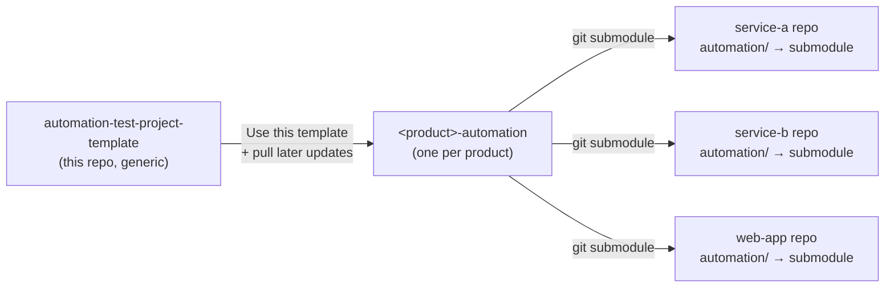

# From template to product: setup and submodule workflow

> **Catatan (HISv3):** nama service/app di dokumen ini (`user-service`, `order-service`, `catalog-gateway`, `customer-portal`, `admin-console`) adalah _contoh fiktif_ dari template awal untuk menjelaskan pola; implementasinya sudah dihapus dan `mock-server/` tidak ada lagi. Service HISv3 yang sebenarnya: [hisv3-services.md](hisv3-services.md). Repo ini **sudah** menjadi repo produk HISv3, jadi langkah "mengganti template" di bawah hanya berlaku untuk repo turunan.

How to turn this template into the automation repo of **one product**, and how the product's own repositories
(services, frontends) use it as a git submodule.

## Table of contents

1. [The model](#1-the-model)
2. [Step 1 — Create the product automation repo](#2-step-1--create-the-product-automation-repo)
3. [Step 2 — Customize it for the product](#3-step-2--customize-it-for-the-product)
4. [Step 3 — Embed it as a submodule in each product repo](#4-step-3--embed-it-as-a-submodule-in-each-product-repo)
5. [Daily workflows](#5-daily-workflows)
6. [CI in the product repos](#6-ci-in-the-product-repos)
7. [Pitfalls](#7-pitfalls)
8. [When not to use submodules](#8-when-not-to-use-submodules)

---

## 1. The model



- **One automation repo per product**, shared by all of that product's sibling repos. This is where tests spanning several
  repos (e.g. _merchant creates a product → customer buys it_) live, in `tests/e2e-journeys/` or in the primary target's folder.
- Each product repo pins the automation repo at a **specific commit**. Developers can change tests from inside their own repo;
  QA can work in the automation repo directly.
- This template stays generic. Product-specific names never flow back into it.

## 2. Step 1 — Create the product automation repo

1. On GitHub: **Use this template** → name it `<product>-automation` (kebab-case), visibility private, owner = your org.
2. Clone it and keep a link to the template so you can pull improvements later:

   ```bash
   git clone git@github.com:<org>/<product>-automation.git && cd <product>-automation
   git remote add template git@github.com:<org>/automation-test-project-template.git
   ```

3. Pull template updates later (the template-created repo has unrelated history, so the first merge needs a flag):

   ```bash
   git fetch template
   git merge template/main --allow-unrelated-histories   # first time only; plain `git merge template/main` afterwards
   ```

   Resolve conflicts in the product files (usually `config/targets.ts`, `config/env.ts`, `CODEOWNERS`). To keep merges small,
   avoid reformatting or renaming framework files (`src/api/core/`, `src/fixtures/` structure, `playwright.config.ts`).

## 3. Step 2 — Customize it for the product

Fill in the **product profile** first; every later step is derived from it.

| Item                        | Example                                | Used in                                        |
| --------------------------- | -------------------------------------- | ---------------------------------------------- |
| Product name                | `marketplace`                          | repo name, `package.json` `name`, README title |
| REST services               | `payment-service`, `inventory-service` | `config/targets.ts` → `restServices`           |
| GraphQL endpoints           | `search-gateway`                       | `config/targets.ts` → `graphqlEndpoints`       |
| Web apps                    | `merchant-portal`                      | `config/targets.ts` → `webApps`                |
| Roles and test accounts     | `customer`, `admin`, `merchant`        | `Role`, `credentials`, `env/*.example`         |
| Environments                | `local`, `staging`                     | `env/.env.*.example`, CI variables             |
| Owning teams                | see the table below                    | `.github/CODEOWNERS`                           |
| Report / notification place | Slack `#marketplace-qa`                | CI workflow                                    |

Checklist, in this order:

1. **Remove the demo targets** (`user-service`, `order-service`, `catalog-gateway`, `customer-portal`, `admin-console`) from
   `config/env.ts`, `config/targets.ts`, `env/*.example`, `src/api/**`, `src/web/**`, `src/fixtures/**`, `tests/**`,
   `tests/setup/**`. Remove their lines from `.github/CODEOWNERS`.
2. **Reset the test catalog:** replace the demo epics in `docs/test-catalog/` with the product's epics (copy `_template.md`), then run `npm run catalog:report`.
3. **Add your real targets** with the recipes in [AGENTS.md §7.2–7.4](../AGENTS.md) and the worked examples in
   [multi-service-collaboration.md](multi-service-collaboration.md) §8–9 (written in Bahasa Indonesia). Always: env var → registry
   entry → client/page objects → fixture → setup → specs → CODEOWNERS line.
4. **Decide on the extras:** delete `mock-server/` if the product has a real local stack (set `START_MOCK_SERVER=false`),
   keep or delete `mobile/`, rename the package in `package.json`, retitle the README.
5. **List the teams** and map them to folders in `.github/CODEOWNERS` (every team must exist in the GitHub org with write access):

   | Team                  | Owns (src + tests mirror)                   | CODEOWNERS handle          |
   | --------------------- | ------------------------------------------- | -------------------------- |
   | QA platform           | `config/`, `src/fixtures/`, `src/api/core/` | `@<org>/qa-platform`       |
   | `<payment>` team      | `payment-service` (REST)                    | `@<org>/payment-team`      |
   | `<merchant-web>` team | `merchant-portal` (web)                     | `@<org>/merchant-web-team` |

6. **Add a product section to `AGENTS.md`** for rules specific to this product (naming, forbidden shortcuts, data constraints).
7. **Configure CI** (`.github/workflows/e2e.yml`): repository variables for the URLs, secrets for the accounts. Names only
   in the repo; values in the password manager / GitHub secrets (see README §8).
8. **Definition of ready:** `npm run check` passes and the `@smoke` tests pass 3× on `TEST_ENV=local`.

> Changes to `config/**`, `src/fixtures/**`, `.github/**` and `package.json` need a human reviewer from the QA platform team
> (AGENTS.md §6.3). That applies to the product repo too.

## 4. Step 3 — Embed it as a submodule in each product repo

In every service/app repo of the product:

```bash
git submodule add git@github.com:<org>/<product>-automation.git automation
git commit -m "chore: add automation submodule"
git config submodule.recurse true          # pull/checkout also update the submodule
```

Anyone cloning the product repo afterwards:

```bash
git clone --recurse-submodules git@github.com:<org>/<service>.git
# already cloned without it:
git submodule update --init
```

Run the tests of that repo's slice from inside the product repo:

```bash
cd automation
npm ci && npx playwright install --with-deps chromium && npm run env:init
npx playwright test tests/api/rest/<service>
```

The product repo stores only a **pointer to one commit** of the automation repo. Nothing changes in the product repo until
someone commits a new pointer.

## 5. Daily workflows

### A developer changes a test from inside the product repo

```bash
cd automation
git switch -c feat/payment-refund-tests      # never work on a detached HEAD
# edit, then run `npm run check` and the changed spec 3×
git push -u origin feat/payment-refund-tests # open a PR in the AUTOMATION repo; CODEOWNERS routes the review
```

After the PR is merged:

```bash
cd automation && git switch main && git pull
cd .. && git add automation && git commit -m "chore: bump automation to latest main"   # PR in the product repo
```

Order matters: **merge the automation PR first, then bump the pointer.** A pointer to an unmerged or unpushed commit breaks
everyone's clone.

### QA works in the automation repo directly

Clone `<product>-automation` on its own, work as in any Playwright repo, and merge to `main`. Product repos pick the change up
the next time their pointer is bumped. This is also where cross-repo journeys are written, because it can reach every service
and app of the product through `config/targets.ts`.

### Updating the pointer

```bash
git submodule update --remote automation     # move to the tip of the tracked branch
git add automation && git commit -m "chore: bump automation"
```

## 6. CI in the product repos

```yaml
# .github/workflows/e2e.yml in a service repo (sketch)
on:
  pull_request:
    paths: ['src/**', 'automation'] # `automation` = the submodule pointer
jobs:
  e2e:
    runs-on: ubuntu-latest
    steps:
      - uses: actions/checkout@v4
        with:
          submodules: true
          token: ${{ secrets.AUTOMATION_REPO_READ_TOKEN }} # needed because the submodule is a private repo
      - uses: actions/setup-node@v4
        with: { node-version-file: automation/.nvmrc }
      - run: npm ci && npx playwright install --with-deps chromium
        working-directory: automation
      - run: npx playwright test tests/api/rest/<service> --grep @smoke
        working-directory: automation
        env:
          TEST_ENV: staging
          # URLs and credentials come from repo/org variables and secrets, never from files
```

Recommended pipelines:

| Where           | Trigger                    | Runs                                                                                                              |
| --------------- | -------------------------- | ----------------------------------------------------------------------------------------------------------------- |
| Service repo    | PR, deploy to staging      | that service's folder + `@smoke`, with the pinned commit                                                          |
| Automation repo | PR                         | `npm run check` + affected specs                                                                                  |
| Automation repo | nightly                    | full `@regression` on `main` incl. cross-repo journeys                                                            |
| Automation repo | merge to `main` (optional) | open "bump pointer" PRs in product repos (`repository_dispatch`, or Dependabot `package-ecosystem: gitsubmodule`) |

Secrets and environment URLs live in the CI settings of whichever repo runs the tests; they are never committed
(AGENTS.md §6.1).

## 7. Pitfalls

| Problem                                                  | Prevention                                                                                        |
| -------------------------------------------------------- | ------------------------------------------------------------------------------------------------- |
| Pointer drift: sibling repos pinned to different commits | Nightly job on automation `main`; automated bump PRs; bump pointers regularly                     |
| Parent repo points to a commit that was never pushed     | Push/merge the automation PR before committing the pointer; `git push --recurse-submodules=check` |
| Edits lost on a detached HEAD                            | Always `git switch -c <branch>` inside `automation/` before editing                               |
| Clone has an empty `automation/` folder                  | `git submodule update --init` or clone with `--recurse-submodules`                                |
| CI cannot fetch the private submodule                    | `submodules: true` plus a read token/deploy key                                                   |
| Breaking API change in a service                         | Change the client/schema in the automation PR and bump the pointer in the same release            |
| Template improvements never reach the product repo       | Merge `template/main` into the automation repo regularly (Step 1)                                 |

## 8. When not to use submodules

- Every team already works in one repo → use the npm-workspaces monorepo in [architecture.md](architecture.md) §3.
- Teams need independent tooling versions → publish `core` as an internal npm package (architecture §4).
- Developers rarely touch tests → clone the automation repo side by side and let CI check out both repos by name,
  instead of pinning a pointer.
